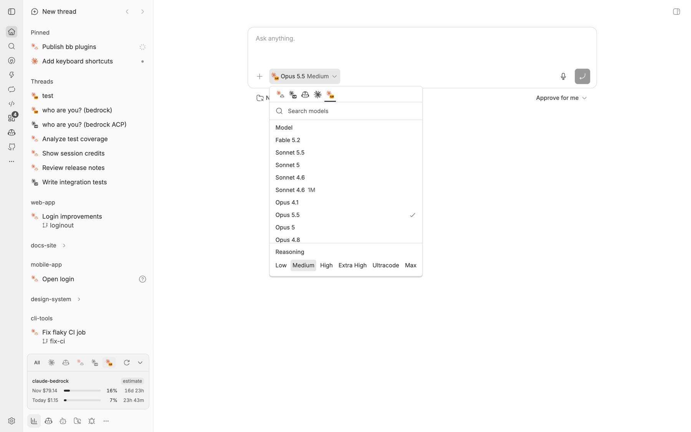
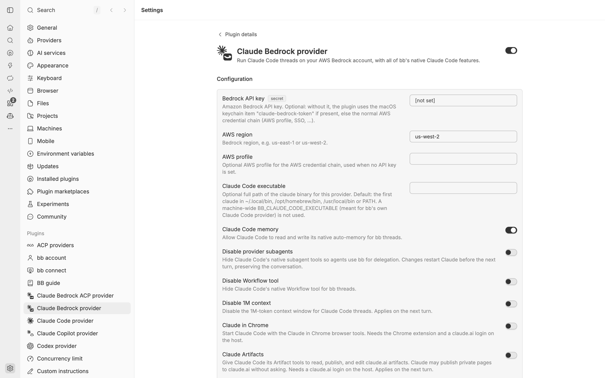

# bb-plugin-claude-bedrock

**Claude Code (Bedrock)** as its own provider in [bb](https://getbb.app): Claude
Code running against **Amazon Bedrock**, next to bb's normal Claude Code
provider, which keeps using your Anthropic login.

It is bb's own Claude Code provider, so Bedrock threads get everything a normal
Claude Code thread has in bb: plan mode, approvals and permission modes,
subagents and workflows, skills, rewind and fork, compaction and the context
meter. Only the backend differs.

## Screenshots

**Claude Code (Bedrock)** in the model picker, with the Bedrock models Claude
Code reports, and its estimated spend in the Provider usage panel (bottom
left):



The plugin settings: Bedrock API key, region, AWS profile, Claude Code
executable, monthly budget and price factor, then bb's usual Claude Code
options.



## Requirements

- bb 0.49 or later.
- [Claude Code](https://claude.com/claude-code) installed on the machine (`claude`).
- Access to the Anthropic models on Amazon Bedrock, with a
  [Bedrock API key](https://docs.aws.amazon.com/bedrock/latest/userguide/api-keys.html)
  or AWS credentials that Claude Code can use (see
  [Claude Code on Amazon Bedrock](https://docs.claude.com/en/docs/claude-code/amazon-bedrock)).

## Setup

1. Install the plugin. From a clone:

   ```sh
   git clone https://github.com/alexkli/bb-plugin-claude-bedrock.git
   cd bb-plugin-claude-bedrock
   npm install
   bb plugin build
   bb plugin install .
   ```

2. Open Settings → Plugins → **Claude Bedrock provider** and set:
   - **Bedrock API key**. bb stores it as a secret setting. Without it, the
     plugin uses the macOS keychain item `claude-bedrock-token` if present
     (`security add-generic-password -a "$USER" -s claude-bedrock-token -w`),
     else the normal AWS credential chain; set **AWS profile** for that.
   - **AWS region**, default `us-east-1`.

3. Pick **Claude Code (Bedrock)** in a new thread.

## Usage entry

The plugin adds estimated spend for `claude-bedrock` to bb's Provider usage
panel and footer: this month and today, against a monthly budget. Today's
budget is the monthly budget divided by the days in the month.

- **Monthly budget (USD)**, default 100.
- **Price factor**, default 1 (list price). For a negotiated Bedrock discount
  or markup, e.g. 0.8 for 20% below list.

The numbers are Claude Code's own list-price cost estimates, not your AWS bill.
bb doesn't show a cost for Claude Code threads, so the plugin records it
itself: `bin/claude-bedrock` runs the real `claude` behind
`bin/claude-cost-tap.mjs`, which passes Claude Code's output through unchanged
and appends each session's running cost to
`${XDG_STATE_HOME:-~/.local/state}/claude-bedrock/cost.jsonl` (src
`bb-claude-code`). That ledger is shared with the Claude Bedrock ACP provider
plugin and other tools. Each line names the Bedrock credential it was spent
with: a 12-character SHA-256 fingerprint of the API key (never the key), or
the AWS profile. The usage entry counts all lines for the credential this
plugin uses, whatever wrote them, so the budget covers everything spent with
that API key on this machine. Lines from before credentials were recorded
count for every credential. Recording needs Node.js on
the machine; without it, `claude` runs directly and nothing is recorded.

## How it works

`vendor/provider-claude-code` is bb's built-in Claude Code provider
(`plugins/provider-claude-code` in [get-bb/bb](https://github.com/get-bb/bb),
MIT), copied verbatim at a bb release; `vendor/UPSTREAM` names the tag and
commit. bb maintains that plugin as forkable: a copy builds and tests with
public packages only.

This plugin's own code is small and sits outside `vendor/`:

- `server.ts` runs the upstream plugin with a slightly changed plugin API
  instead of patching it. `src/declaration.ts` gives the provider its own id
  (`claude-bedrock`), name, icon and sign-in copy, and drops what only applies
  to a claude.ai login: guided sign-in, the claude.ai usage entry, the OAuth
  token passthrough and fast mode. The Bedrock settings come before Claude
  Code's own settings. In place of upstream's claude.ai usage entry, the
  plugin registers its own (`src/usage.ts`).
- The server contributes this provider's environment: `CLAUDE_CODE_USE_BEDROCK=1`,
  `AWS_REGION`, the API key as `AWS_BEARER_TOKEN_BEDROCK` (or `AWS_PROFILE`),
  and `BB_CLAUDE_CODE_EXECUTABLE` pointing at `bin/claude-bedrock`, which runs
  a plain `claude` (`CLAUDE_BEDROCK_CLAUDE`) and records its cost. A
  machine-wide `BB_CLAUDE_CODE_EXECUTABLE` wrapper meant for bb's own Claude
  Code provider does not apply here.
- `host.ts` re-exports upstream's host entry and bridge. bb sends the
  contributed environment with each model list request, but upstream's model
  probe uses the bridge process's environment only; the bridge applies the
  request's environment first, so the picker lists the Bedrock models.
  Upstream also names models from Anthropic API ids only; for Bedrock ids
  (`us.anthropic.claude-sonnet-5-5`, `…-v1:0`) it falls back to labels like
  "Sonnet", so the bridge renames them in its model list responses
  (`src/model-names.ts`).
- `app.tsx` draws the provider icon: the Claude mark with an AWS badge, in
  color. (The Claude Bedrock ACP provider plugin uses the same mark in
  monochrome, so the two are easy to tell apart.)

## Staying in sync with bb

`scripts/sync-upstream.sh <tag>` replaces `vendor/` with bb's provider at a
release tag, e.g. `scripts/sync-upstream.sh desktop-v0.49.0`. Then:

```sh
npm install
npm run typecheck
npm test        # upstream's own tests plus this plugin's
bb plugin build
```

The GitHub workflow `.github/workflows/sync-upstream.yml` does this every week
for the newest `desktop-v*` release and opens a pull request when the provider
changed. Review upstream's diff before merging, in particular changes to
`server.ts` and `src/host.ts`, and keep `package.json`'s dependency ranges in
step with upstream's. Permission and security fixes should be merged promptly.

## Development

```sh
npm install
bb plugin install .   # once
bb plugin build . && bb plugin reload claude-bedrock
```

## License

MIT. `vendor/provider-claude-code` is bb's code under its MIT license
(`vendor/LICENSE`).
